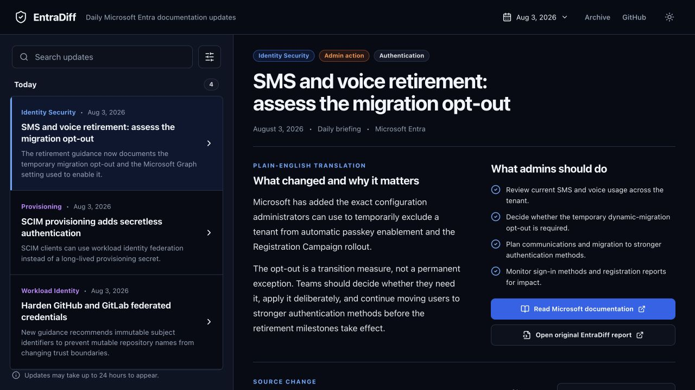
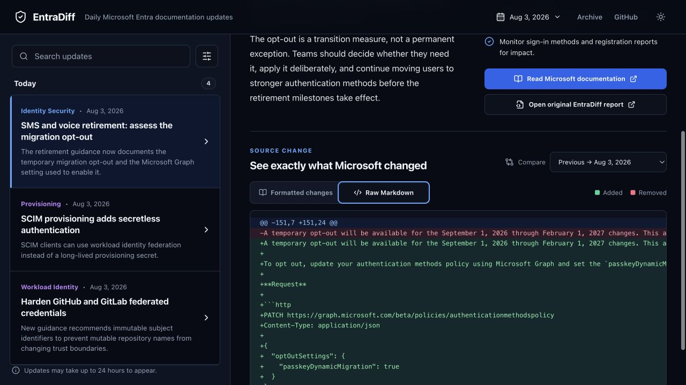

# EntraDiff Prototype UX Audit

## Overall verdict

The prototype is a competent article reader, but it solves the narrow “read one known update” task rather than the broader “understand what changed across time and products” job. Its heavy use of dark panels, pills, symmetric blocks, generic labels, oversized type, and uniformly polished copy creates a familiar AI-generated dashboard feel. The next design should behave more like an editorial archive than an application shell.

## Step 1 — Daily reader overview

Health: Needs structural redesign.

Strengths:

- The selected update has a clear headline and readable explanation.
- Microsoft documentation and EntraDiff evidence links are prominent.
- The left index enables quick movement between the four visible stories.

Issues:

- Opening on a selected article hides the high-level shape of the day.
- The fixed “Today” sidebar provides no useful week or month model.
- Category labels mix product, capability, and editorial concepts: Identity Security, Provisioning, Workload Identity, and User Experience are not one coherent taxonomy.
- Every story has almost identical visual treatment, so importance and breadth are difficult to scan.
- The giant headline, badge row, bordered panels, rounded pills, dual-column summary, and bright full-width CTA are common generated-dashboard patterns rather than a distinctive editorial system.
- “Plain-English translation,” “Daily briefing,” and “See exactly what Microsoft changed” over-explain the interface. Shorter editorial labels would feel more natural.
- The repeated “What…” headings and checklist make every update look action-required, even when a documentation change might only be guidance or clarification.

Accessibility risks visible from the screen:

- Several muted text treatments are small and low-contrast against the dark surface.
- Category meaning depends heavily on colour.
- The dense two-column summary may be harder to follow at narrower desktop widths.

## Step 2 — Raw Markdown evidence

Health: Useful secondary feature, poorly placed in the overall journey.

Strengths:

- Formatted and raw views are clearly differentiated.
- Additions and removals use familiar diff colours.
- The raw source remains available for technical verification.

Issues:

- The user must scroll through a long article before reaching evidence.
- The source area inherits the same panel-heavy treatment as the rest of the page.
- The raw diff becomes visually dominant once selected, despite being a secondary mode for most readers.
- There is no stable, indexable URL shown for the selected change or evidence state because the prototype is a client-rendered React view.

## Step 3 — Microsoft Entra product structure

Health: Strong source for a more durable information architecture.

Observed product groups:

- Microsoft Entra ID
- Microsoft Entra Agent ID
- Microsoft Entra ID Protection
- Microsoft Entra ID Governance
- Microsoft Entra External ID
- Microsoft Entra Internet Access
- Microsoft Entra Private Access
- Microsoft Entra Verified ID
- Microsoft Entra Workload ID
- Security Copilot + Microsoft Entra

Observed cross-product areas:

- Fundamentals
- Architecture
- Standards
- Microsoft identity platform
- Troubleshooting

Recommendation:

Use time and product as equal navigation dimensions. Time answers “what changed since I last visited?” Product answers “what changed in the area I own?” Every update should have a canonical static detail page, with static day, week, month, and product index pages linking to it.

## Highest-impact design changes

1. Replace the persistent article/sidebar homepage with an archive-first digest.
2. Add Day, Week, and Month views as true static index pages with meaningful URLs.
3. Tag each update with a controlled product taxonomy plus a cross-product topic where necessary.
4. Use importance sparingly through order, typography, and a single editorial marker rather than many badges.
5. Make the summary sound like a concise editor wrote it; remove AI-signalling labels and formulaic repeated sections.
6. Keep formatted diff as the default on canonical change pages and raw Markdown as a secondary disclosure or tab.
7. Generate complete semantic HTML at build time so headings, summaries, links, and diff content are crawlable without JavaScript.

## Evidence limits

This audit covers the current desktop prototype overview, raw-diff state, and visible Microsoft Entra documentation taxonomy. Keyboard order, screen-reader announcements, responsive behaviour, and production content variability require separate implementation testing.
